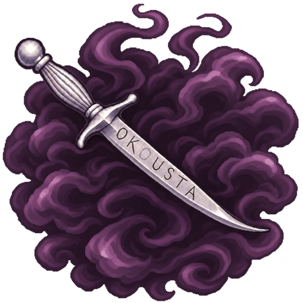

# Okusta



Okusta is a browser extension for reading a webpage with a model and keeping a journal of the conversation. Ask a question, pick a passage or HTML element, or draw a box around something you want a vision model to see. A saved entry keeps the source and replies together so you can return to them or branch the conversation later.

Extract the release ZIP. In Chrome, enable **Developer mode** at `chrome://extensions` and use **Load unpacked** with `dist/chrome`. In Firefox, use **Load Temporary Add-on** with `dist/firefox/manifest.json` from `about:debugging#/runtime/this-firefox`. In macOS Safari, use **Add Temporary Extension** with `dist/safari`. On a webpage, click the Okusta toolbar button or press **Alt+Shift+J**. The book button opens the Journal.

## Connect a local model

Okusta talks directly to an OpenAI-compatible server on `127.0.0.1`. The default port is **8765**. If you already have vLLM running, start at step 2.

1. From the Okusta project directory, activate your vLLM environment. Start **one** model on the GPU machine and leave the server running.

   | Use | Command |
   | --- | --- |
   | Text and screenshot questions with Gemma 3 4B | `bash scripts/start-local.sh google/gemma-3-4b-it` |
   | Text questions with Qwen3 4B | `bash scripts/start-local.sh Qwen/Qwen3-4B-Instruct-2507` |

   If the weights are already on disk, pass the checkpoint directory as the launcher argument. For a first Gemma download, the account downloading it needs access to the model on Hugging Face. If the browser runs on another machine, open a tunnel **on the browser machine**, using your workstation’s SSH name in place of `your-gpu-host`.

   ```bash
   ssh -N -L 8765:127.0.0.1:8765 your-gpu-host
   ```

2. From the browser machine, check which model the server is advertising.

   ```bash
   curl http://127.0.0.1:8765/v1/models
   ```

3. Open **Journal → Settings → Model connection**. Choose **Local model**, set the server port, and click **Test & use model**. Leave **Served model ID** blank to detect a single base model, or paste the exact `id` from step 2.

With a vision model, the test sends a small built-in PNG. When the model accepts it and the browser supports capture, the panel’s eye opens. Click the eye, drag over a region of the visible tab, then press **Send** for a description or **Query** to ask about the crop. The selected PNG goes to the model.

## Use a hosted API

The bundled Python helper reads your provider key and sends requests to the provider. Start it on the browser machine. You can use a hosted model with either Journal storage option.

1. Make the key available in the helper’s environment. The variable name depends on the provider.

   | Provider | Environment variable |
   | --- | --- |
   | OpenRouter | `OPENROUTER_API_KEY` |
   | OpenAI | `OPENAI_API_KEY` |
   | Anthropic | `ANTHROPIC_API_KEY` |
   | Gemini | `GEMINI_API_KEY` |
   | Groq | `GROQ_API_KEY` |
   | DeepSeek | `DEEPSEEK_API_KEY` |

   Alternatively, put an entry such as `{"openrouter": "your-key"}` in `~/.config/okusta/keys.json`. On macOS or Linux, run `chmod 600 ~/.config/okusta/keys.json`. An environment variable takes precedence over the file.

2. From the Okusta directory, run the helper and leave it running.

   ```bash
   python3 scripts/desk-service.py
   ```

3. In **Journal → Settings → Local helper**, paste the pairing token printed in the terminal and click **Pair helper**. The helper listens on `127.0.0.1:8766`.
4. Under **Model connection**, choose the provider, enter a chat model ID available to your account, and click **Test & use model**. The test sends a short prompt and may incur a charge. For hosted screenshot questions in 0.90, use **OpenRouter** with a model that advertises image input. A submitted question sends the prompt, the entry’s conversation, and any selected source or crop to that provider.

## Use the Journal

- **Capture and save.** In the panel, **Query** takes a prompt. The lightning bolt picks a page element. Press **T** to switch between HTML and readable text. Click the disk to save the clipping and its conversation. To save after each completed reply, enable **Journal → Settings → Recording → Autorecord**. Closing the panel discards unsaved turns.
- **Follow a reply.** **Enter** sends and clears the input. **Shift+Enter** adds a line. The send triangle becomes a stop square while a reply is pending or streaming. The panel follows the reply until you scroll yourself and resumes following on the next submission.
- **Find an entry.** Open the book and expand a date under **Journal days**. Clicking a title jumps to its entry. As you scroll, the sidebar highlights the entry in view. Each saved clipping shows its source, any captured text or image, and the model’s replies.
- **Continue or branch.** **Continue** appends a question and reply to the same entry. **Split** copies the source and conversation into a new entry dated today, so you can try a different line of questioning. **Delete** removes the selected entry and its replies. A response cut short by the token limit is marked **Partial answer**. **Regenerate** keeps the earlier answer alongside the new one.
- **Organize or replay.** Under **Collections**, a configured local LoRA can organize up to 12 selected clippings. To try the replay player offline, choose **Import replay…** and open `examples/collection.okusta-replay.json`.

### Choose where entries are saved

Open **Journal → Settings → Journal location**. Under **Save clippings and replies in**, choose a destination and click **Save location**.

| Destination | Where the entries go | What you need |
| --- | --- | --- |
| **This browser profile** (default) | The current extension’s local storage in this browser profile. | The extension alone can read and write entries. |
| **SQLite file** | A file on the helper machine, for example `~/Documents/Okusta/journal.sqlite`. Enter its path under **Database file**. | Run and pair the helper as described above. Choose a new file or an existing Okusta journal. |

When switching destinations, leave **Copy current entries when switching** checked to merge the current records into the destination. Clear it to open the destination as it stands. The original records stay in their source store. Future saves go to the selected destination. Two browsers can share a journal by pairing with the same helper and opening the same SQLite file. Refresh the Journal in the other browser to see changes.

### Export for reading or analysis

From **Journal location**, choose **Export Markdown** for a readable transcript or **Export JSON** for scripts. Both export **all days in the active store**, including saved crops and collections. Exports are snapshots taken when you click.

| Where you want the exported file | What to set |
| --- | --- |
| Browser downloads | Leave **Export folder** blank and click **Save location**. The browser downloads a timestamped `.md` or `.json` file. |
| A specific directory | With the helper paired, enter an absolute path or a path such as `~/Documents/Okusta/exports` under **Export folder** and click **Save location**. The helper writes exports there. |

Either export destination works with either storage option. For example, you can keep entries in the browser and send JSON snapshots to a project directory, or keep entries in SQLite and download Markdown through the browser.

For direct SQLite access, the `journal` table has a text `key` and a JSON-encoded `value`. Records sharing an entry ID use the prefixes `clip:` (source), `note:` (initial explanation, when present), and `questions:` (saved turns). The JSON export exposes the same keys under `records`. To list saved questions and model replies directly from the example database, run this query with the SQLite CLI.

```bash
sqlite3 -readonly "$HOME/Documents/Okusta/journal.sqlite" <<'SQL'
SELECT substr(j.key, 11) AS entry_id,
       json_extract(turn.value, '$.question') AS question,
       json_extract(turn.value, '$.text') AS reply
FROM journal AS j, json_each(j.value) AS turn
WHERE j.key LIKE 'questions:%'
ORDER BY entry_id, CAST(turn.key AS INTEGER);
SQL
```

<details>
<summary>Upgrading, running a collection adapter, or building from source</summary>

### Upgrade an existing installation

Reload the extension in the same browser profile. For a Chromium unpacked installation, keep the same directory registered in the browser so existing entries and model settings remain accessible. For Firefox, reload the existing temporary add-on. In either case, refresh open Journal and webpage tabs after reloading.

If you used Zerkalo, you can reopen its SQLite file at its original path. The updated helper can also read the previous keys file and local model settings. Restart the helper from the new project and pair the token it prints.

### Local limits and collection adapters

In **Settings → Local model limits**, the output budget applies to the next request. To change the bundled launcher’s context window or GPU budget, pair the helper, save the limits, and restart vLLM on the serving machine with that configuration.

To serve a trained collection LoRA, launch its matching base checkpoint with the adapter path. For example, for an adapter trained on the Qwen starter model:

```bash
OKUSTA_LORA_PATH=/path/to/adapter bash scripts/start-local.sh Qwen/Qwen3-4B-Instruct-2507
```

In **Settings → Collection adapter**, set the served name (default `collection`) and port, then click **Test & use adapter**. Under **Collections → Organize selected clippings**, name the collection, describe which entries belong, select the candidates, and click **Organize clippings**. The panel and Journal continue to use the model selected under **Model connection** for chat.

### Build and test

```bash
python3 build.py --zip
node --test tests/*.mjs
python3 -m unittest discover -s tests
```

</details>

